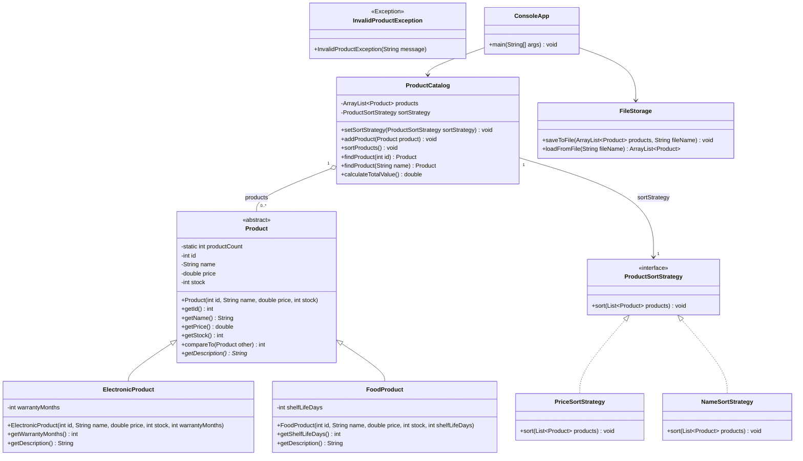

# Tervezési Dokumentáció és UML Osztálydiagram

## 1. Problémafelvetés (Problem Statement)
- **Felhasználók:** Egy kis bolt vagy webáruház kezelője.
- **Cél:** Elektronikai és élelmiszer termékek egyszerű nyilvántartása, keresése, rendezése ár vagy név szerint, valamint fájlba mentése.
- **Megoldott probléma:** A közös `Product` ősosztály segítségével különböző típusú termékeket (`ElectronicProduct`, `FoodProduct`) tudunk egyetlen `ArrayList<Product>` listában tárolni, és a `FileStorage` osztállyal szöveges fájlba menteni.

## 2. UML Osztálydiagram

## 3. Tervezési minta: Strategy (Stratégia)
- **Minta neve:** Strategy
- **Osztályok:** `ProductSortStrategy` (interfész), `PriceSortStrategy` (ár szerinti rendezés `Comparable`-lel), `NameSortStrategy` (név szerinti rendezés lambda kifejezéssel), és `ProductCatalog` (ami használja a stratégiát).
- **Miért jó:** A `ProductCatalog.setSortStrategy(...)` meghívásával futás közben tudunk váltani az ár szerinti és a név szerinti rendezés között anélkül, hogy a `ProductCatalog` kódját átírnánk.

## 4. Tervezési döntések és korlátok
- **Döntések:** Egyszerű pontosvesszővel (`;`) tagolt szöveges fájlba (`data/catalog.csv`) mentünk `BufferedWriter` és `BufferedReader` (`try-with-resources`) használatával.
- **Korlátok:** Csak konzolos felület van, és az adatok egyszerű szöveges fájlban tárolódnak, nincs adatbázis.
