# UML Osztálydiagram és Tervezési Dokumentáció (Prog 2 Projektmunka)

## 1. Problémafelvetés (Problem Statement)

- **Felhasználók (Users):** Webáruház-üzemeltetők, raktárkezelők és vásárlók.
- **Céljuk (Goal):** Egy átlátható, gyorsan kereshető és többféle szempont (ár szerint növekvő/csökkenő, név, raktárkészlet) szerint rendezhető termékkatalógus kezelése, amely különböző terméktípusokat (elektronikai cikkek, élelmiszerek) képes egységesen tárolni és fájlba menteni.
- **Megoldott probléma (Problem Solved):** A különféle tulajdonságokkal rendelkező termékek (pl. garanciaidős elektronikai eszközök és szavatossági idős/bio élelmiszerek) közös absztrakció (`Product`, `Describable`) mögé szervezése, az üzleti szabályok (érvényes ár, készlet, egyedi azonosító) szigorú ellenőrzése (`InvalidProductException`), a rendezési irányelvek futásidejű rugalmas váltása (**Strategy tervezési minta**), valamint az adatok futások közötti megőrzése (CSV és bináris Java szerializáció `try-with-resources` segítségével).

---

## 2. UML Osztálydiagram (Mermaid formátum)

Az alábbi UML osztálydiagram közvetlenül megjeleníthető GitHubon és Markdown-megjelenítőkben (a szerkeszthető PlantUML forrás a [`docs/uml-class-diagram.puml`](uml-class-diagram.puml) fájlban található):

```mermaid
classDiagram
    direction TB

    class Describable {
        <<interface>>
        +getId() int
        +getDescription() String
    }

    class ProductCategory {
        <<enumeration>>
        ELECTRONICS
        FOOD
        -String displayName
        +getDisplayName() String
    }

    class InvalidProductException {
        <<Exception>>
        +InvalidProductException(String message)
        +InvalidProductException(String message, Throwable cause)
    }

    class Product {
        <<abstract>>
        -static int createdProductCount
        -int id
        -String name
        -double price
        -int stock
        -ProductCategory category
        #Product(int id, String name, double price, int stock, ProductCategory category)
        +validateBasicFields(int id, String name, double price, int stock, ProductCategory category) void
        +static getCreatedProductCount() int
        +getId() int
        +getName() String
        +getPrice() double
        +getStock() int
        +getCategory() ProductCategory
        +getTotalStockValue() double
        +compareTo(Product other) int
        +getDescription()* String
    }

    class ElectronicProduct {
        -int warrantyMonths
        +ElectronicProduct(int id, String name, double price, int stock, int warrantyMonths)
        +getWarrantyMonths() int
        +setWarrantyMonths(int warrantyMonths) void
        +getDescription() String
    }

    class FoodProduct {
        -int shelfLifeDays
        -boolean organic
        +FoodProduct(int id, String name, double price, int stock, int shelfLifeDays, boolean organic)
        +getShelfLifeDays() int
        +isOrganic() boolean
        +getDescription() String
    }

    class ProductSortStrategy {
        <<interface>>
        +getStrategyName() String
        +sort(List~Product~ products) List~Product~
    }

    class PriceAscendingSortStrategy {
        +getStrategyName() String
        +sort(List~Product~ products) List~Product~
    }

    class PriceDescendingSortStrategy {
        +getStrategyName() String
        +sort(List~Product~ products) List~Product~
    }

    class NameSortStrategy {
        +getStrategyName() String
        +sort(List~Product~ products) List~Product~
    }

    class StockSortStrategy {
        +getStrategyName() String
        +sort(List~Product~ products) List~Product~
    }

    class ProductCatalog {
        -String catalogName
        -List~Product~ products
        -ProductSortStrategy sortStrategy
        +ProductCatalog(String catalogName)
        +setSortStrategy(ProductSortStrategy sortStrategy) void
        +addProduct(Product product) void
        +removeProduct(int id) boolean
        +findProduct(int id) Product
        +findProduct(String name) Product
        +getSortedProducts() List~Product~
        +getMostExpensiveProduct() Product
        +calculateTotalInventoryValue() double
        +loadDefaultSampleProducts() void
    }

    class CatalogRepository {
        <<interface>>
        +save(List~Product~ products, Path filePath) void
        +load(Path filePath) List~Product~
    }

    class CsvCatalogRepository {
        +save(List~Product~ products, Path filePath) void
        +load(Path filePath) List~Product~
    }

    class BinaryCatalogRepository {
        +save(List~Product~ products, Path filePath) void
        +load(Path filePath) List~Product~
    }

    class ConsoleApp {
        -ProductCatalog catalog
        -CatalogRepository csvRepository
        -CatalogRepository binaryRepository
        +main(String[] args) void
        +initializeCatalog() void
        +runDemo() void
        +runInteractiveMenu() void
    }

    Describable <|.. Product : implements
    Product <|-- ElectronicProduct : extends
    Product <|-- FoodProduct : extends
    Product "1" *-- "1" ProductCategory : category

    ProductSortStrategy <|.. PriceAscendingSortStrategy : implements
    ProductSortStrategy <|.. PriceDescendingSortStrategy : implements
    ProductSortStrategy <|.. NameSortStrategy : implements
    ProductSortStrategy <|.. StockSortStrategy : implements

    ProductCatalog "1" o-- "0..*" Product : aggregates
    ProductCatalog "1" --> "1" ProductSortStrategy : uses strategy

    CatalogRepository <|.. CsvCatalogRepository : implements
    CatalogRepository <|.. BinaryCatalogRepository : implements

    ConsoleApp "1" *-- "1" ProductCatalog : owns
    ConsoleApp "1" --> "2" CatalogRepository : uses
```

---

## 3. Tervezési minta magyarázata: Strategy (Stratégia) minta

A projektben a **Strategy (Stratégia)** tervezési mintát alkalmaztuk a katalógus rendezési irányelveinek szétválasztására és futásidejű cserélhetőségére.

### Résztvevő osztályok és szerepük:
1. **Strategy interfész (`hu.prog2.catalog.strategy.ProductSortStrategy`):**
   Meghatározza a közös szerződést (`List<Product> sort(List<Product> products)` és `String getStrategyName()`) minden rendezési algoritmus számára.
2. **Konkrét stratégiák (`ConcreteStrategy`):**
   - `PriceAscendingSortStrategy`: A `Comparable<Product>` természetes rendezését (`Collections.sort`) használja ár szerint növekvő sorrendhez.
   - `PriceDescendingSortStrategy`: Lambda-kifejezéssel (`(p1, p2) -> Double.compare(p2.getPrice(), p1.getPrice())`) rendezi a termékeket ár szerint csökkenő sorrendbe.
   - `NameSortStrategy`: A `Comparator<Product>` segítségével kis- és nagybetű-független ábécésorrendbe rendezi a termékeket.
   - `StockSortStrategy`: Egy másik `Comparator<Product>` segítségével raktárkészlet szerint növekvő sorrendbe rendezi a termékeket.
3. **Környezet (`Context` — `hu.prog2.catalog.service.ProductCatalog`):**
   Tartalmaz egy `private ProductSortStrategy sortStrategy` referenciát, amely a `setSortStrategy(...)` metódussal futásidőben bármikor lecserélhető, a `getSortedProducts()` pedig delegálja a rendezést az aktuális stratégiának.

### A minta előnyei a tervezésben:
- **Open/Closed Principle (Nyitva-zárt elv):** Új rendezési szempont (pl. készletérték vagy kategória szerinti rendezés) bevezetéséhez nem kell módosítani a `ProductCatalog` vagy a `Product` osztályokat, elegendő egy új `ProductSortStrategy` implementációt készíteni.
- **Polimorf működés:** A rendezési stratégiák a közös `Product` őstípuson dolgoznak, így az `ElectronicProduct` és `FoodProduct` leszármazottak `getDescription()` felülírása mellett is minden rendezési funkció változatlanul működik.

---

## 4. Főbb tervezési döntések és ismert korlátok

### Tervezési döntések:
1. **Rétegzett csomagstruktúra:** A felelősségi körök tisztán elkülönülnek: `domain` (üzleti entitások és saját kivétel), `strategy` (rendezési stratégiák), `service` (katalógus-kezelés), `persistence` (CSV és bináris fájlkezelés), valamint `ui` (konzolos felület).
2. **`final` validációs metódus az ősosztályban:** A `Product.validateBasicFields(...)` metódus `final` módosítót kapott, hogy egyetlen leszármazott osztály se tudja megkerülni az alapvető üzleti szabályokat (pozitív ID, nem üres név, nem negatív ár és készlet).
3. **Kettős perzisztencia (`try-with-resources`):** Mind az ember által olvasható szöveges CSV (`CsvCatalogRepository`), mind a szabványos Java objektum-szerializáció (`BinaryCatalogRepository`) megvalósításra került a `CatalogRepository` interfész mögött.

### Ismert korlátok:
- **Egyfelhasználós lokális fájlkezelés:** Az adatok lokális fájlokban (`data/catalog.csv`, `data/catalog.bin`) tárolódnak, így párhuzamos, többfelhasználós adatbázis-tranzakciókat nem támogat.
- **Konzolos felület:** Az alkalmazás parancssori (CLI) felülettel rendelkezik (grafikus GUI nem készült, mivel a kiírás szerint a konzolos felület a kötelező).
